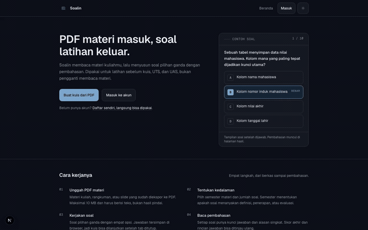
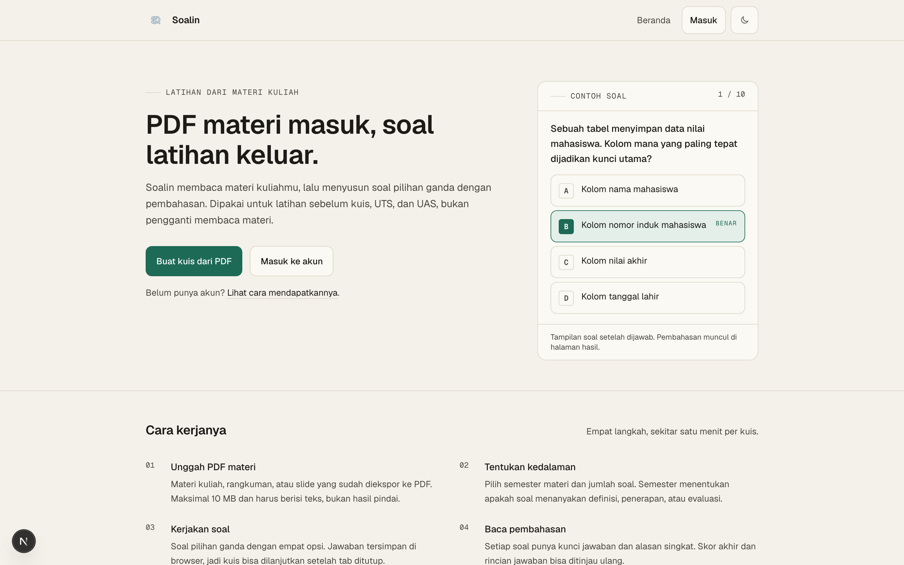
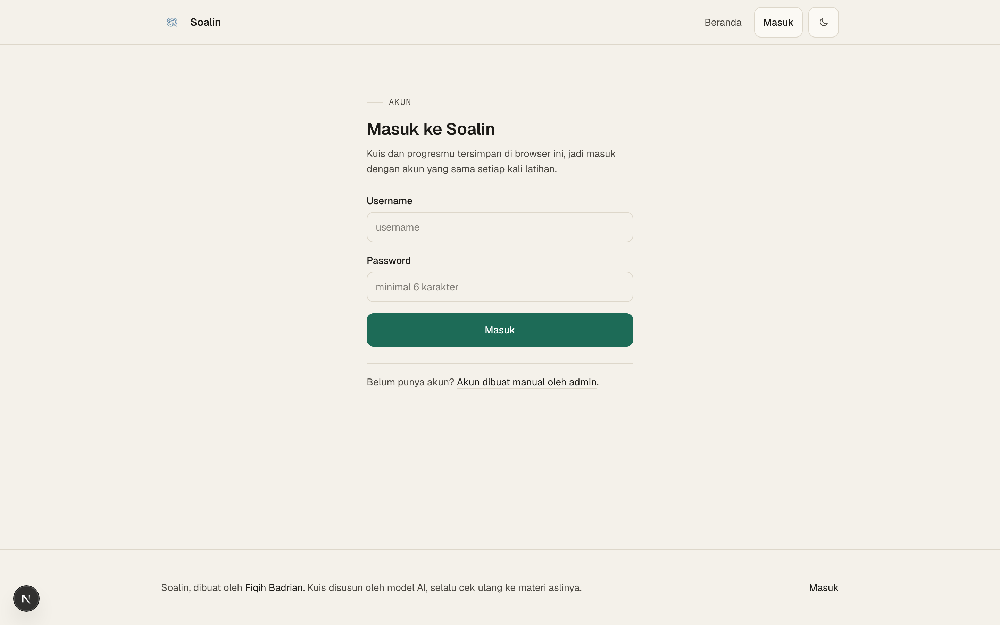
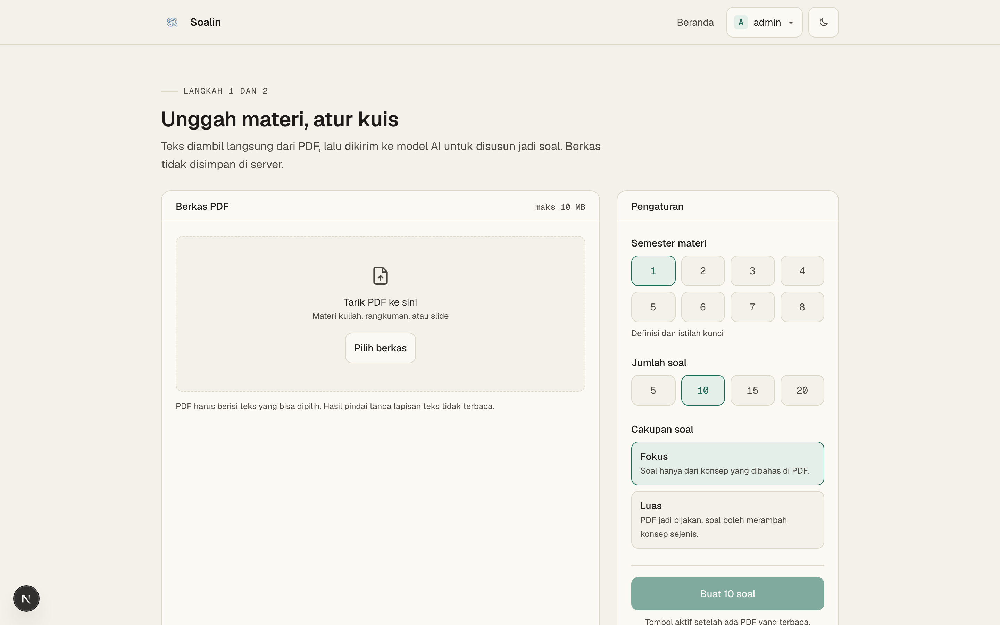

# Soalin - Project Preview

Preview aplikasi kuis otomatis berbasis AI dari materi PDF.

Live demo: https://soalin.fiqihbadrian.my.id/

Repository ini memuat source code aplikasi beserta dokumentasi desainnya.

## Tentang Project

Soalin membantu pengguna belajar lebih cepat dengan cara mengubah materi kuliah (PDF) menjadi kuis pilihan ganda secara otomatis.

Pengguna cukup:
1. Login.
2. Upload PDF materi/rangkuman.
3. Pilih tingkat semester dan jumlah soal.
4. Kerjakan kuis dan lihat hasil serta pembahasan.

## Fitur Utama

- Generate kuis otomatis dari PDF menggunakan AI.
- Pengaturan tingkat kesulitan berdasarkan semester (1-8), masing-masing dengan jenis soal berbeda.
- Opsi jumlah soal: 5, 10, 15, atau 20.
- Soal pilihan ganda 4 opsi (A-D) dengan pembahasan tiap soal.
- Mode sumber soal:
	- Fokus: hanya pada topik dari PDF.
	- Luas: boleh memperluas konsep umum yang masih satu tema.
- Upload PDF dengan validasi file (hanya PDF, maksimal 10MB).
- Hasil kuis menampilkan skor, persentase, dan review jawaban.
- Progress kuis tersimpan di browser, jadi bisa lanjut mengerjakan.
- Navigasi nomor soal untuk pindah atau meninjau jawaban sebelum selesai.

## Sistem Akses

- Halaman kuis dilindungi login.
- Registrasi terbuka: pengguna bisa membuat akun sendiri dari halaman daftar, langsung masuk tanpa konfirmasi.
- Panel admin tersembunyi tetap ada untuk membuat akun secara manual, misalnya saat pendaftaran ditutup:
	- Membuat user baru.
	- Melihat daftar user.
	- Menghapus user.

## Alur Penggunaan

1. Daftar akun sendiri, atau masuk kalau sudah punya.
2. Upload file PDF materi.
3. Sistem mengekstrak teks dari PDF.
4. Pilih semester, jumlah soal, dan cakupan soal.
5. AI membuat kuis sesuai konfigurasi.
6. Kerjakan kuis per soal sampai selesai.
7. Lihat nilai akhir dan review pembahasan.

## Tampilan

Tema mengikuti preferensi sistem dan bisa diganti manual lewat tombol di header. Palet, tipografi, radius, dan aturan gerak dijelaskan di [DESIGN.md](DESIGN.md).

## Demo



Rekaman pemakaian dari awal sampai akhir, 90 detik tanpa suara: daftar akun, unggah PDF, atur semester dan jumlah soal, kerjakan kuis, baca pembahasan, ganti tema, lalu panel admin. Versi MP4 ada di [images/demo-soalin.mp4](images/demo-soalin.mp4).

## Teknologi yang Digunakan

- Next.js 16 (App Router, Turbopack) + React 19 + TypeScript
- Tailwind CSS 4 dengan token warna di CSS
- next-themes untuk tema terang dan gelap
- OpenRouter (LLM API)
- pdf-parse (ekstraksi teks PDF)
- Supabase (data user dan sesi hasil)
- JWT cookie auth + bcrypt
- Zustand (state management)

## Menjalankan Secara Lokal

```bash
npm install
cp .env.example .env.local
npm run dev
```

Variabel yang wajib diisi ada di `.env.example`, terutama `AUTH_SECRET` (minimal 32 karakter), kredensial admin, kunci OpenRouter, dan kunci Supabase.

## Perlindungan Penyalahgunaan

- Pendaftaran dan masuk dibatasi per alamat IP: 5 akun baru dan 10 percobaan masuk per 10 menit.
- Pembuatan soal dibatasi 12 kuis per jam per akun (atau per IP kalau belum masuk), karena tiap kuis memakai kuota model AI.
- Ekstraksi PDF dibatasi 20 unggahan per 10 menit, maksimal 10 MB, dan isi berkas harus benar-benar PDF (dicek dari tanda tangan `%PDF-`, bukan dari nama file).
- Teks yang dikirim ke model dibatasi 400 ribu karakter supaya biaya per permintaan tidak meledak.
- Penyimpanan sesi kuis butuh login dan dibatasi 30 permintaan per 10 menit.
- Hitungan batas disimpan di memori proses secara bawaan. Untuk produksi, isi `UPSTASH_REDIS_REST_URL` dan `UPSTASH_REDIS_REST_TOKEN` supaya batas berlaku lintas instance dan tidak hilang saat restart.

## Catatan

- PDF hasil scan gambar tanpa OCR biasanya tidak bisa diekstrak dengan baik.
- Kualitas dan kecepatan generate soal mengikuti model AI yang digunakan.

## Kontak

Project by Fiqih Badrian

- Website: https://fiqihbadrian.my.id
- Demo app: https://soalin.fiqihbadrian.my.id/


## Live Preview (Gambar)





---

*Terakhir diperbarui: 8 November 2026*
